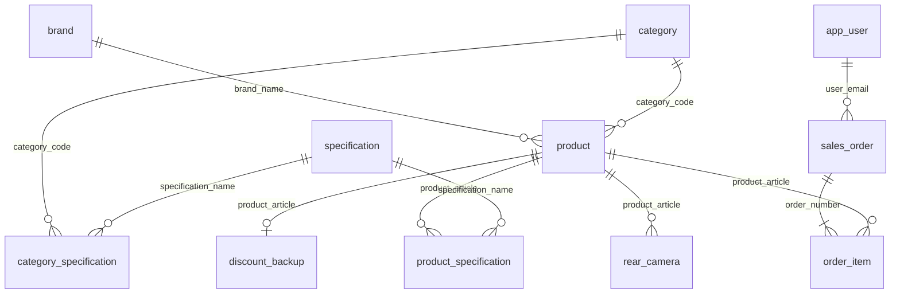

# Схема хранения

Основные таблицы и ключи оставлены из предоставленного SQL.

`discount_state` — одна строка (`id=1`), хранит флаг скидки и используется для
блокировки конкурирующих изменений каталога.
`product_article_seq` — последовательность выдачи артикулов.

`product_specification` имеет составной PK `(product_article, specification_name)`.
`category_specification`: `(category_code, specification_name)`.
`rear_camera`: `(product_article, camera_type, resolution_mp)`.
`order_item`: `(order_number, product_article)`.

Картинка показывает предметные связи. Исходные внешние ключи не гарантируют наличие
хотя бы одной позиции в каждом заказе; заказы пока не обслуживаются REST API.
Типы значений характеристик и их принадлежность категории проверяются Java-сервисом.
Прямые SQL-записи должны соблюдать те же правила самостоятельно.
